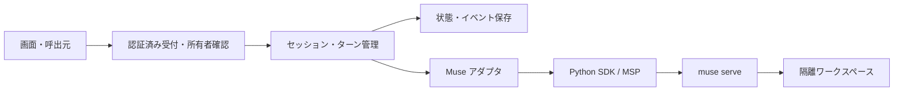

# Muse Code のセッション実行基盤への移行方針

**現在の範囲:** 最新の利用者指定により、実装を進めず段取りの協議に絞る。直近の順序案・協議状態は [次に協議する段取り](projects/muse-code-thin-client/NEXT-STEPS.md) を参照。以下は蓄積した構想・検討記録であり、全項目を最初の作業の前提条件にはしない。

**最新の再協議:** Muse 側の作成報告・CLI 更新・preprint 案を反映して残差を再要約し、Muse の HTTP 200 回答を取得した。[再要約・再協議結果](REPORT.lib.20261110.reconsolidation.md)を現時点の整理とし、作成済み成果の照合→実行条件の分離確認→条件成立後の単発検証の順へ具体化する。実機確認は未実施。

作成日: 2026-11-10 UTC。利用者が指定した[共有ページ](https://cloudflare-workers-github-oauth-1.nekoflare.workers.dev/s/5fbe2ba2/4c2dd78a8e71c177)を読み、Muse と協議してまとめる計画。導入状況・変更履歴・調査中の訂正は [調査記録](REPORT.lib.20261110.muse-code-sdk.md) に分ける。本書は設計・予定であり、実装や配備が完了したことを示さない。

## 追加依頼: 現稼働 Worker からシンクライアントへの移植

利用者は協議後、Muse Code SDK と Tailscale / WASM POST を使う専用 Worker の作成を Muse に依頼するよう指示した。続く指定により、位置づけを「現に動いている Worker からの移植」「既存の対象機能の代替候補となるシンクライアント」とする。既存アプリ全体をゼロから再実装することを目的にしない。

Worker は最小限の受付・認証・通信・状態と結果の受け渡しを担当し、SDK / `muse serve` / ツール・workspace は受信側へ置く方向を Muse に伝えた。現稼働版の特定、移植元と先のファイル・設定・機能対応、SDK 用の追加差分と未対応範囲を明示する。

さらに、WASM が関わるため構想段階からの協議提案も依頼した。実行場所、Go glue / bundle 互換性、認証・DO / Job / session の寿命、受信側との責務分担、最小 PoC と代替評価の段階を比較する。フレームワークは必要性・候補の案のみを求め、導入・依存追加はまだ行わない。既存サービスの切替・停止は行わない。

これらは Muse へ送信した作業・協議の要件であり、専用 Worker の完成や移植完了を確認した記録ではない。以下の段階計画は、この最新の位置づけに沿って具体化する。

## 参考ページから取り入れる観点

指定ページは 2026-11-09 21:46:15 UTC の Muse の回答で、`muse serve`、Codex `app-server`、Claude Agent SDK を、外部プログラムがエージェントのセッションを制御する仕組みとして比較している。この「単なる回答生成 API と、ツール実行を伴うセッション制御を区別する」という観点を採用する。

共有ページの説明自体を仕様書とは扱わない。Muse のセッション上限「256」、ACP アダプタの現状、CLI の全対応機能などは独立検証できていないため、容量設計や依存関係の前提にしない。各製品のワイヤープロトコルが同じ、またはそのまま接続できるとも扱わない。

一次資料との照合:

- [Muse Code SDK README](https://github.com/meta-models/muse-code-sdk/blob/main/README.md): SDK が MSP を通してセッションを制御すること、CLI と SDK の同版対応、版の固定が必要なことを確認。
- [Python SDK の配布情報](https://pypi.org/pypi/muse-code-sdk/json): 1.4.14 の配布、`muse_code` の import、`muse serve` の起動、再開・イベント・承認を扱う SDK の説明を確認。現在のプロジェクトが全機能を実装済みとはしない。
- [Codex App Server 公式文書](https://learn.chatgpt.com/docs/app-server): thread / turn、通知とサーバーからの承認要求を扱う双方向プロトコルを確認。共有ページの「WebSocket はループバック限定」という説明は、現行文書の記述とは一致しないため採用しない。各種トランスポートの有無を、そのまま本プロジェクトで公開する要件にはしない。
- [Claude Agent SDK 公式概要](https://code.claude.com/docs/en/agent-sdk/overview): エージェント実行、セッション、権限を Python / TypeScript から扱えることを確認。Claude 向け移行の実施は本計画の初期必須条件にしない。

## 方針

### Muse との再協議結果

指定ページの抽出本文と Codex の改訂案を Muse へ送り、HTTP 200 で回答を得た。Muse は以下に明示的に同意した。

- 認証済み単発成功を最初の到達点とし、次に `muse serve` 常駐・セッション管理・イベント・承認・取消へ進む。
- 既存の `/agent/code/run` と `/cf-containers/code` を入口として残し、API bridge は別経路として維持する。
- 共通契約を session / turn / event / terminal / error 等の最小集合に絞り、各エンジンのプロトコル全面互換化は行わない。
- ACP / MCP の採用を初期必須にしない。プロセスの生存、SDK の再開、コンテナ再作成後の保存は別の課題として検証する。

Muse は、対象を再確認した範囲では現行実装が要求ごとに `muse serve` を起動する単発方式であり、常駐・再開・承認・取消は未実装と回答した。これは実装点検の報告で、本番イメージとの一致は P0 で確認する。

Muse の変更提案である「管理 agent が serve を所有」「セッションごとのイベント連番」「切断後の再取得」を計画に採用した。一方、Muse が示した既存 HMAC 認証・キー転送の維持だけで複数利用者の境界が十分とはしない。実装点検時に各操作の所有者確認を加える。また、`:unrestricted` は単発試験でも無条件に採用せず、試験前に権限と書込先を決める。

最初の到達点は、既存の単発経路で認証済みの実行を成功させること。その後、`muse serve` とセッションのライフサイクルを管理する基盤へ進む。API bridge による `muse_prompt` は、別の既存経路として扱う。

エンジン間でワイヤープロトコルを変換して全面互換にする方式は採らず、アプリ側の必要最小限の契約を定め、Muse / Codex / Claude のアダプタがそれぞれの SDK やプロトコルを受け持つ案とする。初期実装は Muse に絞り、他エンジンの実装を前提にしない。

これは予定構成図である。HTTP Worker、コンテナ内 agent、保存先の具体的な分担・API パスは実装点検後に確定する。

## 最小の共通契約案

| 項目 | アプリ側で定める内容 |
| --- | --- |
| 識別と所有者 | `session_id`、`turn_id`、`engine`、内部の利用主体・workspace 対応。エンジン側 ID はアダプタが保持 |
| 操作 | セッション作成、ターン開始、状態取得、イベント取得、承認への回答、取消要求。再開は能力と保存状態を確認してから有効化 |
| 状態 | 受付・待機・実行・承認待ち・正常終了・失敗・取消完了を区別。最終状態はエンジンの終端通知等の根拠から確定 |
| イベント | セッション内の順序番号、ターン ID、種類、時刻、本文。`after` 等のカーソルから再取得できる設計を検討 |
| 結果 | 回答、変更差分・成果物参照、実行版、確認結果、終端状態。任意のエンジン固有詳細を格納する拡張欄 |
| エラー | 未設定・認証失敗・利用制限・版不整合・実行失敗・時間切れ・接続断・復旧不能を区別。詳細に秘密値を含めない |
| 重複抑止 | 同じ要求の再送を識別するキーと受付結果の対応。送信結果不明時に無条件で再実行しない |
| 能力情報 | 再開、取消、承認、追加ユーザー入力等を capability として表す。未実装は明示的に未対応を返す |

モデル名、権限プロファイル、承認ペイロード、フォーク、ツールの詳細、プロトコルのバージョンは各エンジン固有のまま残す。見かけの共通化で意味を失わせない。

## ライフサイクルと責任境界

- `muse serve` の所有者はコンテナ内の管理プロセスとする案。HTTP リクエストの寿命に子プロセスの寿命を従属させない。起動、終了、異常終了検知、子プロセス回収を管理する。
- アプリの利用主体と、モデル認証キーの保有者を区別する。セッションの閲覧・入力・承認・取消の各操作で所有者を確認する。複数利用者で同じ作業領域や実行権限を共有する前提にはしない。
- イベント配信の接続断を実行取消と同義にしない。取消要求の受付と、エンジンが停止した確認も区別する。
- SDK の再開機能、プロセス再起動後の復帰、コンテナ再作成後の復旧は別の試験項目とする。SDK の機能があるだけでデータ永続性を保証しない。
- 承認は対象の session / turn / request と判断者を対応させ、回答待ちの期限・拒否・切断時の扱いを定める。
- 初期の同時実行数は1を候補とし、実測して決める。共有ページの上限値を運用上限には流用しない。
- ACP は将来エディタ連携が必要になった時点で比較する。MCP によるツール接続もセッション制御 API の代替とはせず、初期必須依存にしない。

## 移行段階と完了条件

| 段階 | 予定 | 次へ進むための条件 |
| --- | --- | --- |
| P0: 根拠の確定 | 実装ファイル、CLI / SDK 版、認証設定の有無、Builds と配備 SHA を照合。既存の単発 API と権限・時間制限を点検 | ソース・イメージ・稼働設定を区別して説明でき、試験の前提が揃う |
| P1: 単発成功 | 既存 `/cf-containers/code` → `/agent/code/run` を入口に、隔離領域で認証済み回答、その後小編集と確認を実施 | 正常終端、回答、差分、確認結果、認証失敗時の構造化エラーを記録 |
| P2: 常駐セッション | 管理プロセスが SDK / `muse serve` を所有。セッション ID と workspace を対応させ、イベント・承認・取消を実装 | 同じセッションの2ターン、配信再接続、承認、取消、異常終了時の状態確定を確認 |
| P3: 運用・復旧 | 状態と成果物の保存、プロセス・コンテナ再起動、取消と再送、各経路の上限、利用者分離を試験 | データ保持範囲と復旧不能条件、重複実行の防ぎ方、限定導入と戻し方が説明できる |

既存の単発 API は最小試験と互換用の入口として維持する案。常駐化した内部へ委譲する際も、応答形式やタイムアウトの変更は別途明示する。長時間処理を単一 HTTP 応答で待ち続ける方式を維持するか、受付 ID と状態取得へ移すかは実測後に決める。

## 担当と判断事項

Muse は対象 VM の実装点検、SDK 固定案、常駐管理案を担当する想定。このホストの Codex は bridge / 呼出側の整合、取得できる配備情報、共通契約、文書と検証結果の整理を担当する。対象サービスへの権限が確認できない作業を、実行可能な予定として約束しない。

利用者の判断が必要なのは、認証・契約を伴う手続き、公開する利用範囲、試験用 workspace、許可する操作、最大実行時間・同時実行数、保存期間。今回の依頼範囲では調査・協議・文書化まで行い、本書の実装作業は実施していない。

再協議で特に未決として挙がったのは、承認待ちの既定動作、コンテナ再作成を跨ぐ引継ぎの要否、ジョブ・履歴・成果物の保存先、Codex / Claude 対応の優先順位。本計画では初期対象を Muse とする案を示しており、他エンジンへの実装や本番変更の承認を得たとは扱わない。

## Tailscale WASM の通信経路を加える方針

### 参考資料と今回の協議

利用者指定の[追加ページ](https://cloudflare-workers-github-oauth-1.nekoflare.workers.dev/s/5fbe2ba2/7196c30690ddb93f)は `@ai-ecoverse/wasm-tailscale` による POST を説明している。本文を取得し、[上流 README](https://github.com/ai-ecoverse/wasm-tailscale/blob/main/README.md)、[型定義](https://github.com/ai-ecoverse/wasm-tailscale/blob/main/package/index.d.ts)、既存プロジェクトの記録と照合して Muse に提示した。Muse から HTTP 200 の回答を得て、以下を協議した。

WASM はネットワークの経路であり、Muse Code SDK / MSP、アプリの認証、セッションの所有者管理を置き換えない。`muse serve` の stdio と SDK はサーバー側に置き、外側の HTTP / イベント API を WASM が運ぶ案とする。bridge のモデル応答成功を Code のツール実行成功として扱わない。

### 既存の根拠と、先に解決する課題

新規ライブラリ導入ではなく、既存実装との差分から進める。このホストの関連プロジェクトは `@ai-ecoverse/wasm-tailscale 1.104.1-13` を固定しており、lockfile に配布物 integrity がある。導入済み型定義にも POST と応答の読み取り API があることを読んで確認した。

| 既存の経路 | 読んで確認した過去の記録 | 今回の判断 |
| --- | --- | --- |
| 独立したローカル workerd → WASM → bridge | HTTP 200、固有回答マーカー一致 | 通信の成立例。画面・本体 Worker の成功の代用にしない |
| 独立した DO → WASM → bridge | HTTP 200、固有回答マーカー一致、明示 logout 後は停止 | DO 単体の根拠。本体 Job との統合成功とは別 |
| 本体 `/api/aichat/jobs` → WASM → bridge | 202 で受付後 Job は `done`、しかし `museTailscale=unavailable`、マーカー不一致。全 bundle の `syscall/js os.Getpid` panic の記録 | 最優先の切り分け対象。受付・Job 終端を回答成功として表示しない |
| 現在の本番経路 | 11月9日の UI / theme 公開記録はあるが、今回 binding・稼働イメージ・全経路の推論を照会していない | 古い「未配備」も現在の「全経路成功」も断定しない |

根拠は [既存 SPEC](/root/cloudflare-workers-github-oauth-1/SPEC.cloudflare-workers-github-oauth-1.wasm-muse-bridge.20261108.md)、[配備差分台帳](/root/cloudflare-workers-github-oauth-1/DEPLOYMENT-STATE.md)、[本体統合結果](/root/cloudflare-workers-github-oauth-1/artifacts/wasm-tailscale-20261108/aichat-live-e2e-result.jsonl)。今回は記録を読んだだけで、障害の再現・修正や新しい実 POST は行っていない。

### 実行場所の選択

| 候補 | 役割と方針 |
| --- | --- |
| Worker 内 WASM / Durable Object | 既存コードと Job 管理を活かす初期候補。Muse も優先案に同意。全 bundle の起動と本体統合経路が通ることを採用確定条件にする |
| 既存 native Tailscale relay | 明示選択する独立の既存経路として維持。WASM 失敗時の自動切替には使わず、各経路の結果を別々に記録 |
| ブラウザ内 WASM | 初期の実装対象から外す。利用者ごとのノード・認証・保存先・失効方法が必要な独立案。技術的に不可能とは結論しない |

Muse はブラウザ直結を当面不採用にすることを提案し、初期対象から外す点を採用した。共有鍵をブラウザへ配る案は採らない。将来の利用者自身の認証を使う直結案まで永久に否定したものではない。また Muse の「DO が最適」という評価は、未解決の統合障害を解消する前の確定判断にはしない。

### 認証・状態・失敗時の契約

- Tailscale ノード参加、tailnet の通信許可、API 認証、セッション所有者の認可を別々に確認する。CORS の制約を受けない通信でも、API の利用権限があることにはならない。
- Worker の `MUSE_API_KEY`、Code 用 `META_API_KEY`、制御用 HMAC 共有鍵をブラウザへ配布しない。WASM の `stateStorage` はノード鍵を含み得るため、一般の会話表示キャッシュとは分ける。Job ID とノード秘密状態を同じ保存方針で扱わない。
- ノード認証状態、受付 Job、実行 session / turn、イベント保存の寿命を別管理する。WASM / DO の再起動や明示 logout 時に何が残るか確認する。停止・logout 後に勝手に再接続する設計にはしない。
- `response.cancel()`、WebSocket 切断、画面を閉じる操作は、エンジンの取消完了ではない。エンジン取消は別 API の要求と終端結果で確認する。
- 送信後に結果が不明なら `delivery_unknown` 等で残し、通常の実行失敗と区別する。新しいターンの自動再送・自動再実行は行わない。状態照会・既存イベントの再取得は、追加実行を伴わない読取操作として分ける。
- 明示再送も、クライアントがキーを付けるだけで安全とはしない。サーバー側の重複抑止・受付照会が実装されていることを確認してから可能にする。
- WASM 通信、DO / Job、実行ターン、UI 待機の時間制限を個別に記録し、短い側のタイムアウトで実行を取り残さない扱いを決める。イベントカーソルと連番で再取得・重複排除し、保持期限切れも明示する。
- 既存の明示 prefix と手動モデルスイッチの独立性、経路の明示選択、結果不明時の自動 fallback なしを維持する。

### 前回計画へ加える段階と完了条件

以下の W0〜W3 は通信側の追加工程であり、前節の P0〜P3 を置き換えない。

| 工程 | 作業・依存関係 | 完了条件・担当案 |
| --- | --- | --- |
| W0: 本体統合の事実確認 | 固定版・WASM / Go glue・配布元 digest と現配備版を照合。binding / migration、全 bundle 起動、tailnet 到達、API 認証の順に切り分け | Codex 側が接続権限のある環境で根拠を収集。固有 Job ID から実応答と固有マーカー一致まで追跡。HTTP 200 や Job `done` のみでは未完了 |
| W1: 通信と受付の寿命 | W0 後、DO 再起動、ノード認証復元、明示 logout、Job 保存、送信結果不明の状態を検証 | 正常な復元と意図的な停止を区別でき、秘密値をログへ出さず、二重 POST がない。Codex 側が主担当案 |
| W2: Code 制御への接続 | P1 の認証済み単発と P2 の制御 API が前提。受信側の認証・所有者認可・イベント・承認・取消の実装を確認して接続 | Muse 側が SDK / 受信側制約、Codex 側が呼出側を確認。WASM による制御 API の到達と、権限に従う session / turn 操作をそれぞれ検証 |
| W3: 結合・運用試験 | 通信断、時間切れ、取消、再取得、DO / serve / コンテナ再作成を組み合わせる | 送信結果不明・取消完了・失敗を区別できる。イベントと成果物の保存範囲、復旧・戻し方を記録。実行環境と担当は権限を確認して確定 |

受信側の本文上限、並列受付、ストリーミング形式、制御 API の実在と認証状態は今回独立確認できていない。Muse も未確認と回答しており、W2 で確定する。SDK の stdio をネットワークへ公開する案は採用していない。

利用者の判断が必要なのは、将来ブラウザ直結も必要か、ノードと Job / 成果物の保存期間・所有範囲、公開する利用範囲、利用可能な契約・鍵。固有マーカーによる確認、経路別の成功判定、結果不明時の自動再送なしは今回の計画に含める。今回実施したのは調査・Muse との協議・文書追記までである。

## CLI オプションと SDK 設定の適用方針

### 参考ページと確認の分担

利用者指定の[CLI オプション表](https://cloudflare-workers-github-oauth-1.nekoflare.workers.dev/s/5fbe2ba2/e25d9f3922797465)を取得し、Muse に提示して追加協議した。表は機能を探す入口として使い、そのまま SDK 引数やネットワーク公開 API の仕様にはしない。独立確認した一次資料は [公式設定文書](https://dev.meta.ai/docs/muse-code/configuration)、[公式権限文書](https://dev.meta.ai/docs/muse-code/permissions)、[Python SDK 1.4.14 配布物](https://pypi.org/pypi/muse-code-sdk/1.4.14/json)。調査方法と根拠は [REPORT](REPORT.lib.20261110.muse-code-sdk.md) を参照。

### 起動面を分け、実効値を確かめる

Muse は、固定版 CLI / SDK の対応表を作ること、実効設定を記録すること、隔離不成立時に自動で権限を緩めないことに同意した。SDK 単発を主経路とし、承認待ち・質問待ちを明示、継続利用ではログ保持を検討する方針も一致した。

| 設定・機能 | 計画への反映 |
| --- | --- |
| TUI / `exec` / `serve` / SDK | 固定版の各 help と SDK 型を分けて確認。TUI の引数が `serve` でも使えるとは推定しない。SDK 単発を主経路とし、`exec` は必要時の診断候補 |
| 実行バイナリ | 絶対パス、CLI / SDK / MSP 版、起動引数、実行ユーザーを記録。ヘルプ調査は自動更新ランチャーを避け、固定バイナリを候補にする |
| モデル・effort・provider | ページのモデル例を既定値にせず利用可能なものを確認。起動・session・turn のどこで指定し何が優先されるか照合。未確認の引数は送らない |
| workspace | host の `cwd` と session の workspace を対応させる。設定を渡した事実と、実際のファイル操作範囲を分けて試験 |
| profile・承認・ネットワーク | 各設定の要求値と適用結果を記録。既定プロファイル、approval mode、judge を同じ概念として扱わない。実行開始後に勝手に緩めない |
| SDK の profile 適用証明 | 1.4.14 の `StartSessionOptions(permission_profile=..., require_permission_profile=True)` を導入候補にする。session の適用状態を証明できなければターンを送らない設計を検討。現行 agent での採用済みとはしない |
| SDK と CLI の対応 | `MuseClientSpawnOptions.args` に渡す host 引数と、`StartSessionOptions` 等へ渡す session 設定を分ける。CLI の同名オプションを機械的に SDK 引数へ変換しない |

SDK の `StartSessionOptions` で確認できたのはモデル、provider、workspace、approval mode、permission profile 等である。CLI の全機能を同型で持つわけではない。たとえばこの型に `reasoning_effort` フィールドは見当たらず、指定場所を未確認のまま追加しない。

### 固定版 help と参考ページとの差分

Muse が固定バイナリ `muse-bin-1.4.14-R7309.1` を直接調べたとする報告を、対応表の初期資料にする。次の点は実行試験前に確認し直す。

- `serve` の help にはモデル・provider・preset・ログ・設定と sandbox 系がある一方、TUI / exec の承認・effort・permission-profile 等のフラグは掲示されないとの報告。SDK の session 設定がないという意味にはしない。
- 固定版の全体 help はネットワーク値を `restricted` / `enabled` / `proxy-only` と掲示すると報告された。公式現行文書と表記差があるため、最新版の説明を古い固定版へ無条件に適用しない。
- provider の列挙は全体 / `serve` と `exec` で異なると報告された。ページの共通一覧を、そのまま実行面ごとの許可値にはしない。
- 共有ページの終了コード一覧は今回の help で裏付けられなかった。終了理由の分類は SDK / CLI の実際の終端結果で確認してから確定する。

help の掲示、引数の受理、設定の適用、OS による隔離の成立は四つの別項目として記録する。Muse が述べた host 起動時の sandbox 条件と session 側の profile 選択の関係も、SDK の適用証明と対象実機の検査を組み合わせて確認する。

### 実行・承認・保存の意味を取り違えない

- approval の省略と sandbox の無効化は別である。`never`、`--disable-approval`、`--yolo`、`:unrestricted` を同義として扱わず、初期試験で自動採用しない。隔離の成立を確認できなければ環境の問題として報告し、回避目的で権限を広げない。
- Linux の問題は、CLI 起動、認証・契約、SDK ハンドシェイク、bubblewrap 等による OS 隔離、ツール実行の段階に分ける。help 表示や `authRequired` 到達だけでは、シェルが動くと判断しない。
- 承認待ちとユーザー回答待ちは、通常実行中や時間切れと区別する。無人実行には誰が回答するか、未応答時にどう終えるかが必要。フラグ追加だけで対話が解消したことにはしない。
- 継続・再開を試す実行では、`--no-session-log` を安易に既定にしない。残すログ、所有者、保存期間、削除、再開できない実行モードの扱いを先に決める。アプリのイベント保存と CLI の保持状態も別である。
- ステップ上限、利用枠、ターンの時間制限、通信の時間制限、取消を別項目として扱う。CLI の終了コードだけを共通契約の結果へ写像せず、終端イベントと実際の差分・確認結果も用いる。
- `usage` / `config` / `trace` / `export` は導入版の仕様・取得権限を確認して診断へ使う。読み取り目的でも、認証情報・プロンプト・履歴・ローカルパスをそのまま公開しない。共有用の出力は含有内容を点検する。
- `init`、skills の import / update、`auth` / login / logout、設定変更、plugin / MCP 管理、セッション間メッセージ送信は通常のコード実行入口へ一括公開しない。必要な管理機能ごとに対象と権限を別途決める。今回これらの変更操作は行わない。

### P0〜P3 に追加する完了条件

| 段階 | 追加する確認 |
| --- | --- |
| P0 | 固定版 help / SDK 型 / 実装の対応表と、設定の要求値・実効値・根拠を作る。自動更新ランチャーを介した版ずれ、設定優先順位、Linux 隔離の前提を確認 |
| P1 | 選択 profile の適用を確認してから認証済み単発を試す。CLI 起動とツール実行を分け、回答・小編集・確認結果まで判定。使えない環境を `yolo` 等へ自動変更しない |
| P2 | 承認待ち・ユーザー回答待ち・再開可能性を session 状態と対応させる。ログ保持、resume、profile の再適用、取消の結果を検証 |
| P3 | 上限到達・認証失敗・環境不備・通信断・取消を区別し、実効設定と秘匿した診断根拠を残す。保存期間と再作成後の復旧範囲を照合 |

利用者の判断として残すのは、許容するツール・書込先・ネットワーク、承認や質問の回答方法、保存期間と診断情報の共有範囲。具体的なモデル・effort・実行上限は利用可能性と実測を踏まえて決め、ページ内の例をそのまま採用しない。
